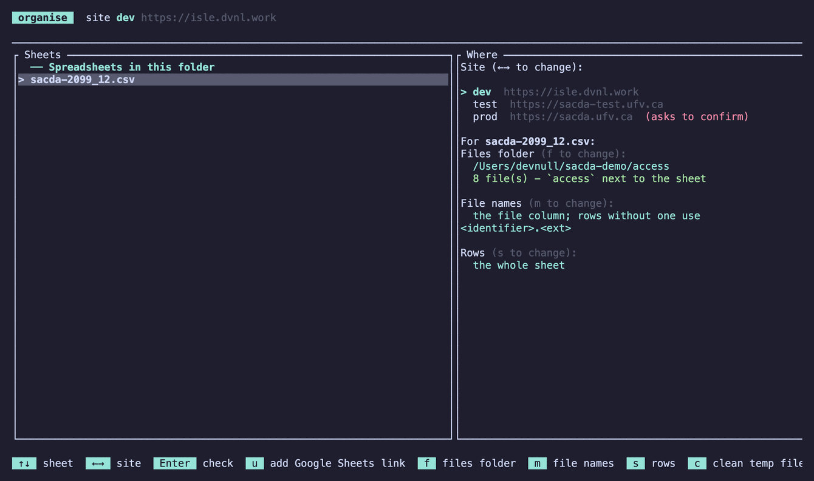
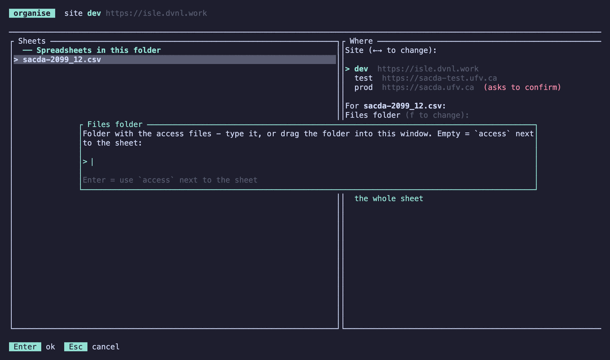
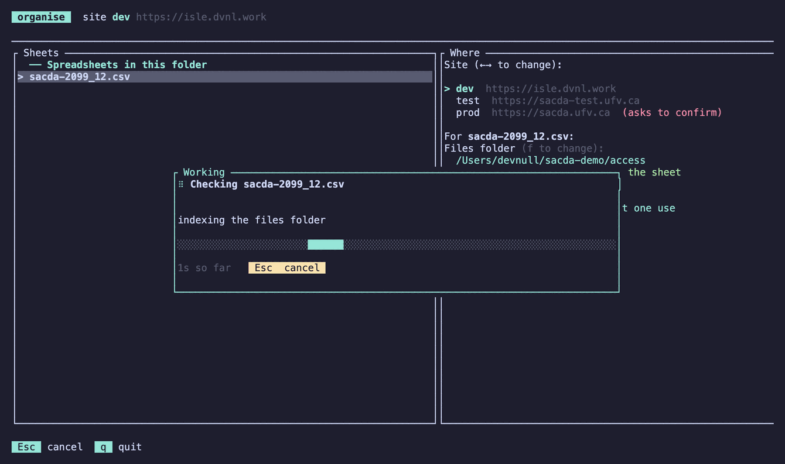
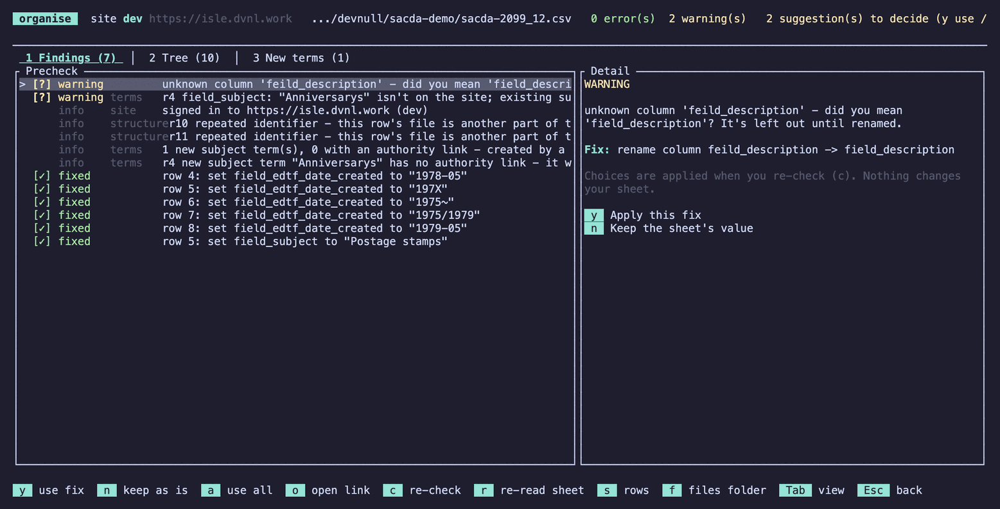
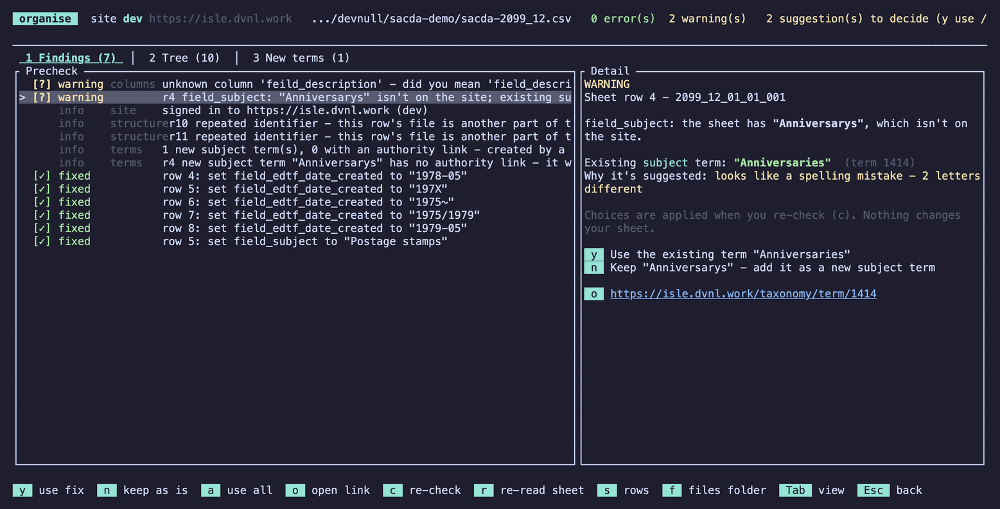
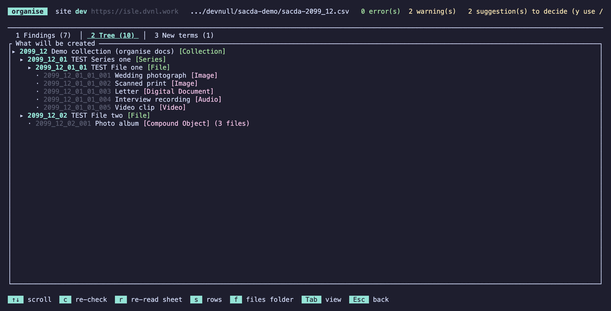
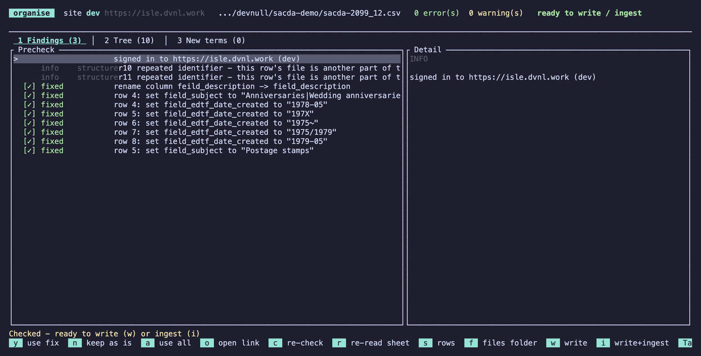
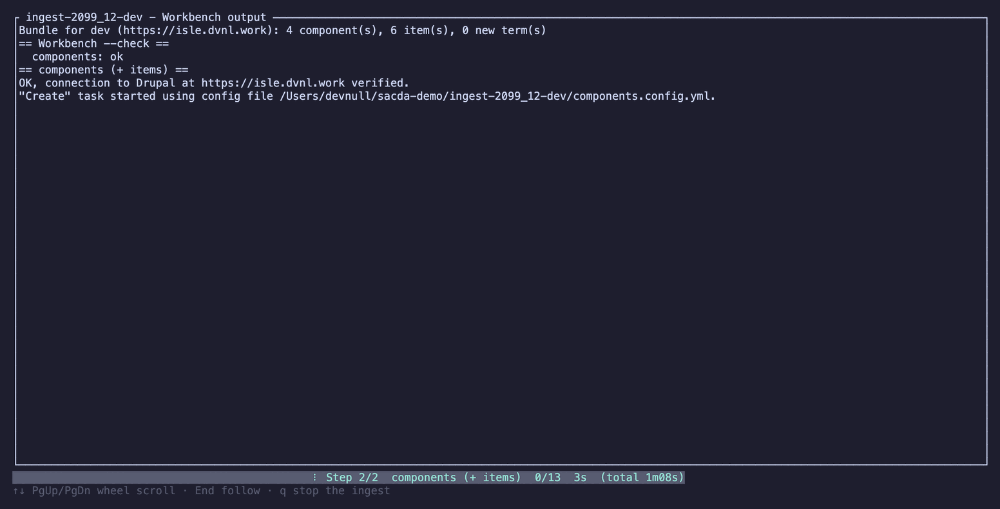
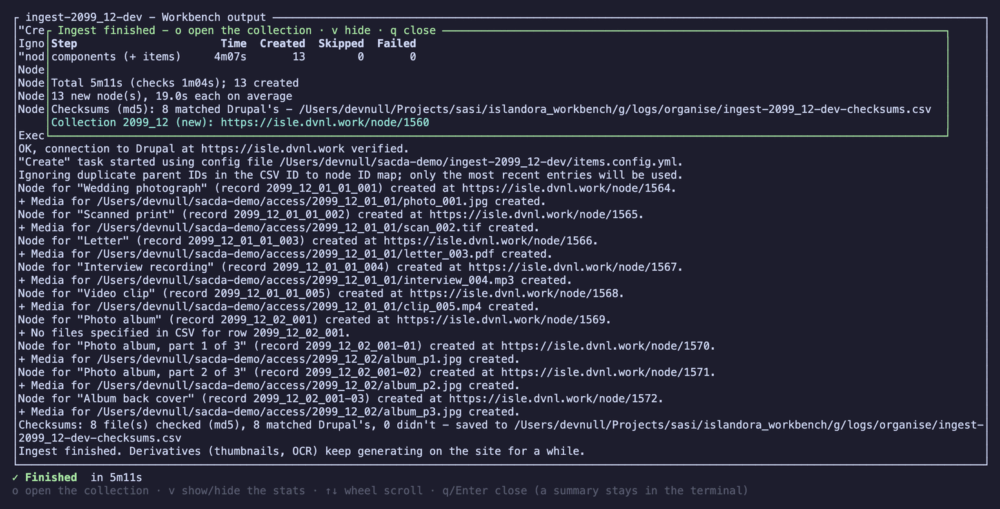
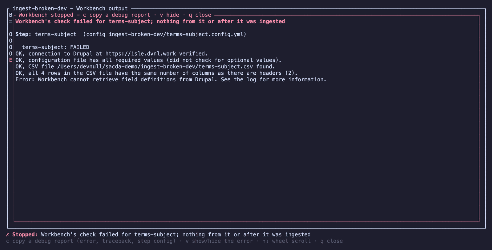

# organise - the SACDA ingest tool

`organise` reads a SACDA spreadsheet and checks it against the archive site. Then it writes an [Islandora Workbench](https://github.com/mjordan/islandora_workbench) bundle and ingests it.

organise works only with the SACDA configuration (the `g/` folder). It is not a general Workbench tool.

The full manual is in the [wiki](https://github.com/south-asian-canadian-digital-archive/workbench-preprocessor/wiki). It describes every screen, key, option and file.

## Install

The SACDA setup script installs organise, Islandora Workbench and the `g/` configuration folder. Your computer probably has them already. To check, open a terminal and type `organise doctor`.

If the command is not found, run the setup script. Ask the SACDA admin for the credentials files.

<details>
<summary>How to run the setup script</summary>

The setup script also updates an existing install. You can run it again at any time.

**Windows** (PowerShell):

```powershell
$UpdateUrl = "https://sacda.ufv.ca/static/update.ps1"; irm $UpdateUrl | iex
```

**macOS / Linux** (Terminal):

```bash
curl -fsSL https://sacda.ufv.ca/static/update.sh | sh
```

The scripts are [update.ps1](https://sacda.ufv.ca/static/update.ps1) and [update.sh](https://sacda.ufv.ca/static/update.sh). Their source is in `scripts/` of the SACDA configuration repository (private).

The script does these steps:

1. It installs uv and Python.
2. It downloads Islandora Workbench and the `g/` configuration folder.
3. It installs `organise` and adds it to your PATH.
4. It runs `organise doctor`.

The credentials files (`credentials-*.yml`) are not in git. Get them from the SACDA admin and copy them into the `g/` folder. Then run `organise doctor` again. Each site that you use must show `ok`.

To install or update only organise, run the release installer:

```bash
curl -fsSL https://github.com/south-asian-canadian-digital-archive/workbench-preprocessor/releases/latest/download/install.sh | sh
```

```powershell
irm https://github.com/south-asian-canadian-digital-archive/workbench-preprocessor/releases/latest/download/install.ps1 | iex
```

More: [Install and update](https://github.com/south-asian-canadian-digital-archive/workbench-preprocessor/wiki/Install-and-update).

</details>

## Ingest a spreadsheet, start to finish

Do these steps for each batch. Ingest into **test** first. Ingest into **prod** only after you examine the result on test.

1. **Prepare the files.** Put the access files in a folder named `access` next to the spreadsheet. You can also use a different folder and select it in step 4.
2. **Open organise.** Open a terminal and type `organise`. The pick screen opens.

   

3. **Select the sheet.**
   - For a file, use ↑ ↓ to select it.
   - For a Google Sheet, press `u` and paste the link. The sheet must be shared as "anyone with the link".
4. **Select the files folder.** Press `f` and type the folder path, or drag the folder into the window. Press Enter. The panel shows how many files the folder holds.

   

5. **Select the site.** Use ← → to select `test` or `prod`.
6. **Start the check.** Press Enter. organise reads the sheet and compares it with the site. This can take some minutes the first time.

   

7. **Read the findings.** The review screen lists each problem. Each line with `[?]` needs a decision.
   - **Error:** change the value in the spreadsheet. Save the sheet, then press `r` to read it again.
   - **Suggestion:** press `y` to use the fix, or `n` to keep the value. Press `a` to use all suggestions.
   - **Rows without files, or files without rows:** press `y` to skip them, or `n` to ingest them.
   - Press `c` to check again after your decisions.

   

   The detail pane tells you why organise suggests a change:

   

8. **Look at the result.** Press `Tab` to see the tree of the collection and the new terms.

   

9. **Write and ingest.** When no problems remain, the footer shows `w` and `i`. Press `i` to write the bundle and ingest it. For prod, type the site name in full.

   

10. **Wait for the ingest.** The ingest screen shows Workbench's output and a progress bar. Do not close the window. To stop the ingest, press `q`, then `y`.

    

11. **Look at the result.** When the ingest ends, a stats panel shows what organise created. Press `o` to open the collection on the site.

    

If the ingest fails, an error panel opens. Press `c` to copy a debug report. Send the report to the SACDA admin.



### Keys on the screen

**Pick screen**

| Key | Action |
|---|---|
| ↑ ↓ | Select a sheet. |
| ← → | Select a site. |
| Enter | Check the sheet. |
| `u` | Add a Google Sheets link. |
| `f` | Set the files folder. |
| `m` | Change the file name rule. |
| `s` | Select the rows. |
| `c` | Delete temporary files. |
| `q` | Quit. |

**Review screen**

| Key | Action |
|---|---|
| `y` / `n` | Use the fix / keep the value. |
| `a` | Use all suggestions. |
| `o` | Open the link. |
| `c` | Check again. |
| `r` | Read the sheet again. |
| `s` / `f` | Change the rows / the files folder. |
| `w` / `i` | Write / write and ingest. |
| `Tab`, `1` `2` `3` | Change the view. |
| Esc | Go back. |

**Ingest screen**

| Key | Action |
|---|---|
| ↑ ↓ PgUp PgDn | Scroll. |
| End | Follow the output. |
| `q` | Stop the ingest. |
| `v` | Show or hide the stats or the error. |
| `o` | Open the collection. |
| `c` | Copy the error report. |

The footer of each screen shows the keys you can use now. You can also use the mouse.

## Commands

```
organise                         open the screen
organise sheet.xlsx --site test  open the screen with this sheet
organise doctor                  check this computer and each site
organise ingest <bundle-folder>  ingest a bundle that organise wrote before
```

`organise --help` lists all options. The [Command line](https://github.com/south-asian-canadian-digital-archive/workbench-preprocessor/wiki/Command-line) page describes them.

## For developers

organise is a Rust workspace. `crates/core` holds the checks and the bundle writer. `crates/tui` holds the screen. The root package is the `organise` binary.

- Build: `cargo build --release`
- Test: `cargo test --workspace`
- Release: Actions → **Draft release (multi-platform)** → Run workflow

More: [For developers](https://github.com/south-asian-canadian-digital-archive/workbench-preprocessor/wiki/For-developers).

## License

MIT. See [LICENSE](LICENSE).
